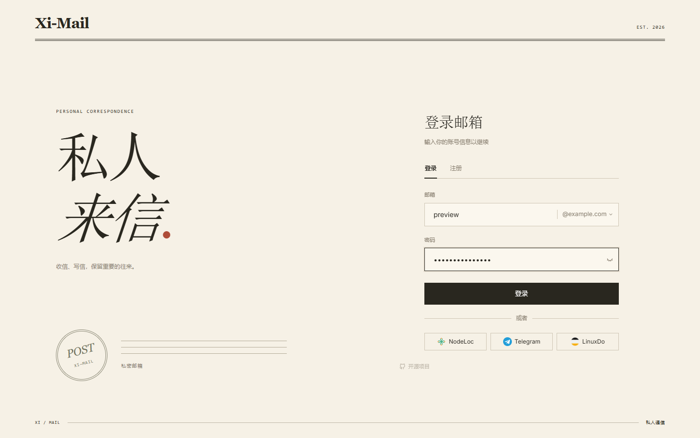
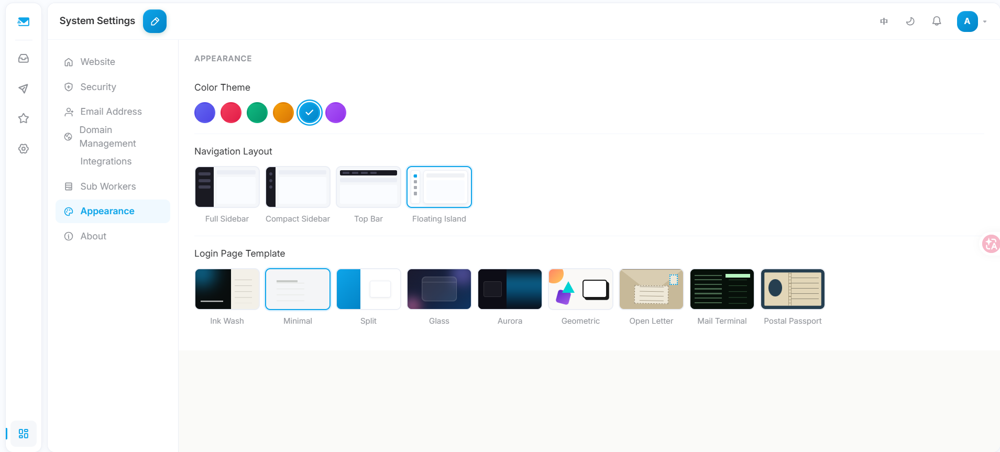
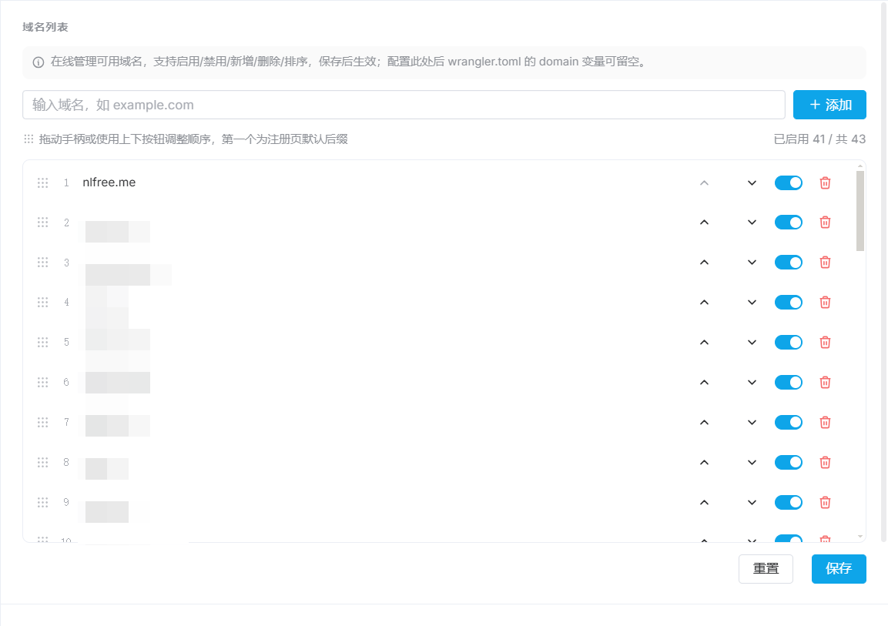
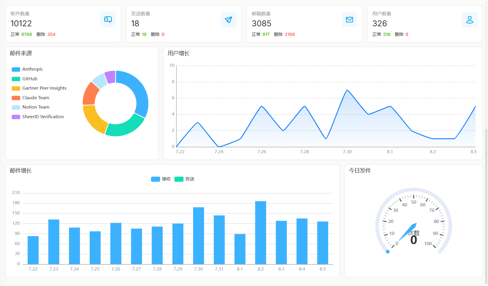
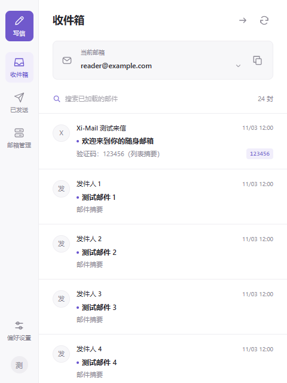
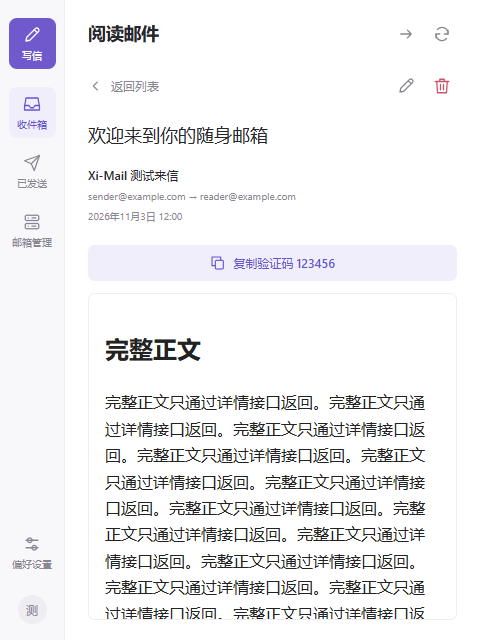
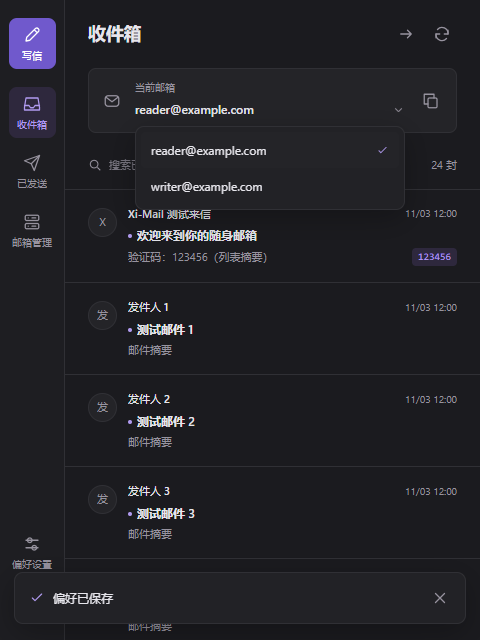

<div align="center">


# Xi-Mail

**Self-hosted mail service built entirely on Cloudflare**

A fork of [cloud-mail](https://github.com/maillab/cloud-mail) with a full UI redesign and a growing feature set

[](https://github.com/PastKing/xi-mail/releases)
[](LICENSE)
[](https://github.com/PastKing/xi-mail/stargazers)
[](https://t.me/pk_oa)

[简体中文](README.md) | [繁體中文](README-zh-TW.md) | [English](README-en.md)

</div>

With a single domain hosted on Cloudflare you can deploy a complete mail platform — multi-account, multi-domain, tiered permissions — at no cost. It runs on Workers + D1 + KV + R2, with no servers to maintain.

---

## 📸 Preview

| Login template | Floating Island |
|:---:|:---:|
|  |  |
| **Domain management** | **Analytics** |
|  |  |

More screenshots: [online preview](https://xi-mail-docs.azx.us/en/guide/preview).

## ✨ Highlights

- **Mail**: multiple mailboxes, compose and reply, code extraction; Resend, QueenSMTP, SendFlare and Cloudflare Email sending.
- **Domains and filtering**: manage domains in the dashboard, with sender allowlists, blocklists and keyword filters.
- **Users and permissions**: tiered roles, invitation codes, mailbox transfers, expiring inbox-sharing links and session management.
- **Provider sign-in**: connect NodeLoc, Telegram, Discord, GitHub, Google or LinuxDo to an existing mailbox.
- **Appearance**: six login templates, six color themes and four navigation layouts, with mobile support and English/Chinese UI.
- **Flexible deployment**: deploy together or with a standalone frontend; connect multiple Workers and receiving sub-workers.
- **API integration**: query mail with a global API token for use in other tools.

---

## 🧩 Browser extension

A companion Chrome extension for reading mail, copying verification codes and managing mailboxes in the browser.

| Inbox | Reading | Dark · switch mailbox |
|:---:|:---:|:---:|
|  |  |  |

- Inbox, sent, compose and reply, with one-click code copying
- Mailbox management, multiple accounts and new mail notifications
- Floating window with light and dark themes

**Install**: download the [browser extension](doc/plug-in/chrome-plug.zip), unzip it, enable Developer mode at `chrome://extensions`, load the folder, then sign in with your own site URL and account.

Requires Chrome 120 or later.

---

## 🚀 Deployment

See the [Xi-Mail deployment guide](https://xi-mail-docs.azx.us/guide/deploy) for Cloudflare dashboard setup, CLI deployment, first-time initialization, receiving domains, and project updates.

---

## 🛠️ Stack and layout

Backend: Cloudflare Workers with Hono, Drizzle ORM and D1 / KV / R2. Frontend: Vue 3, Vite, Element Plus, Pinia, TailwindCSS 4 and vue-i18n.

```
xi-mail/
├── wrangler.toml      # Git dashboard deploy: build command is built in, leave Path empty
├── mail-worker/       # Main worker: API, business logic, auth, migrations
├── mail-view/         # Vue 3 frontend: layout, pages, login templates, themes, i18n
├── mail-worker-sub/   # Sub-worker template: mail receiving + API, with its own docs
└── doc/images/        # Screenshots
```

---

## 💬 Community and support

[GitHub](https://github.com/PastKing/xi-mail) · [Telegram @pk_oa](https://t.me/pk_oa) · upstream [maillab/cloud-mail](https://github.com/maillab/cloud-mail)

If this project helps you, USDT donations are welcome:

| Network | Address |
|---------|---------|
| BEP20 (BSC) | `0x555390f5c07cf76cc344f42612196e8669e3586b` |
| TRC20 (TRON) | `TVqK4thJCsaaWvp1Dah9F5CFZ1iqw75f4G` |

---

## 📄 License

[MIT License](LICENSE). The upstream project [maillab/cloud-mail](https://github.com/maillab/cloud-mail) is also MIT licensed, and its original copyright notice is preserved here.
