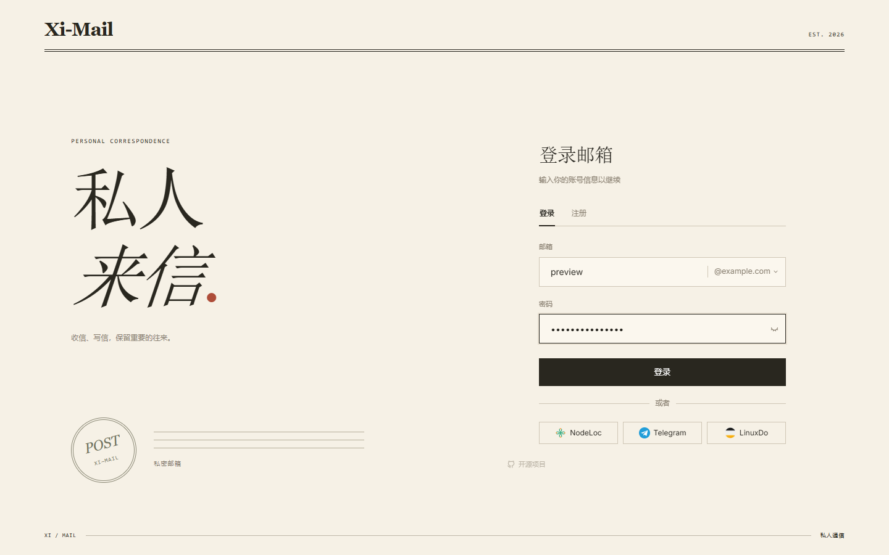
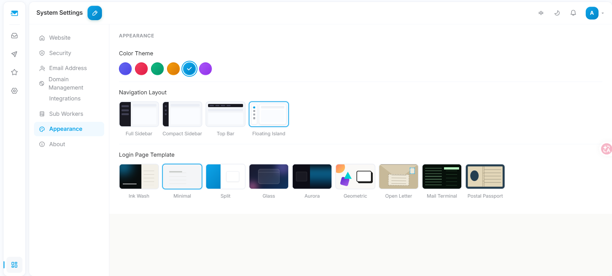
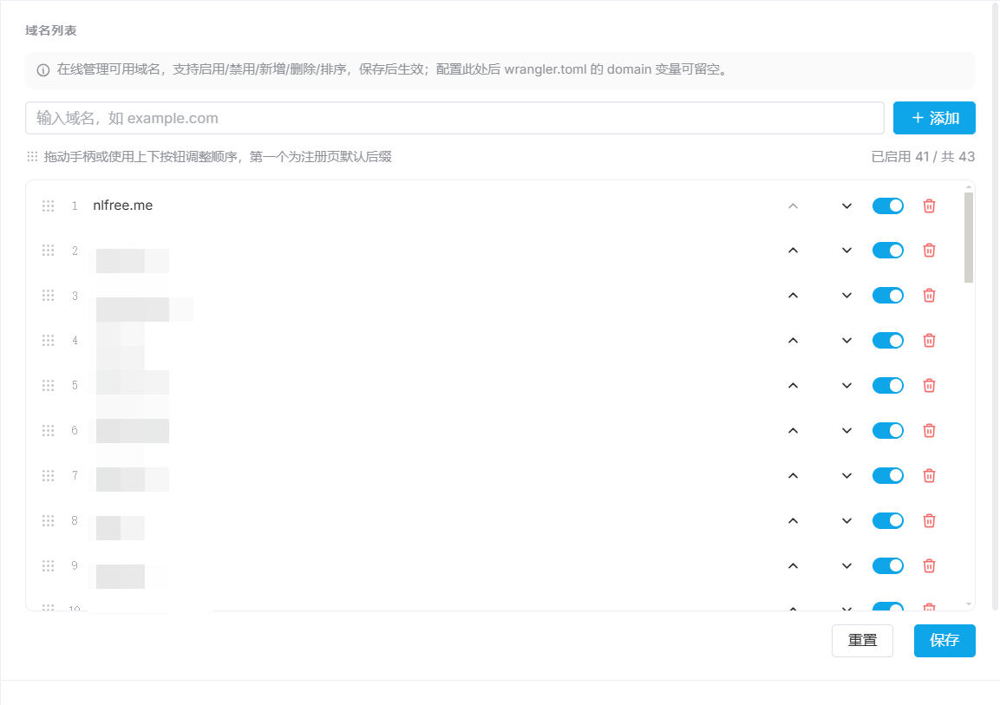
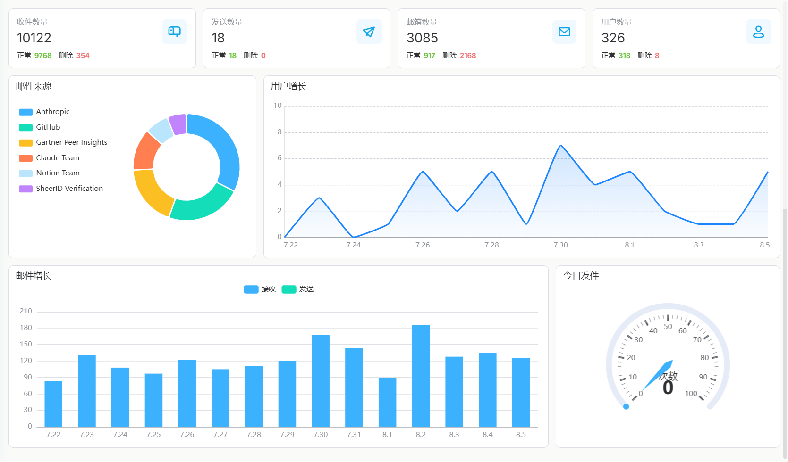
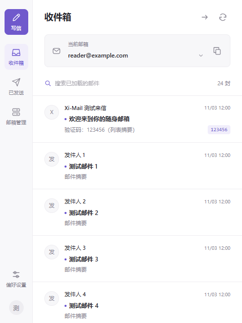
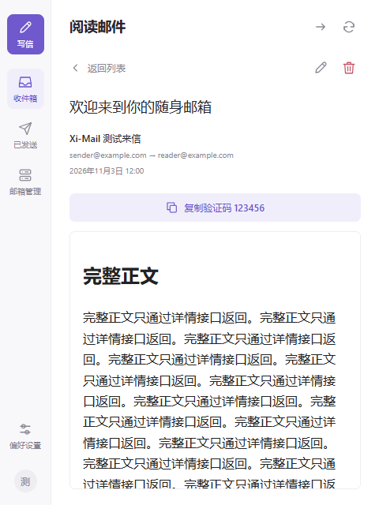
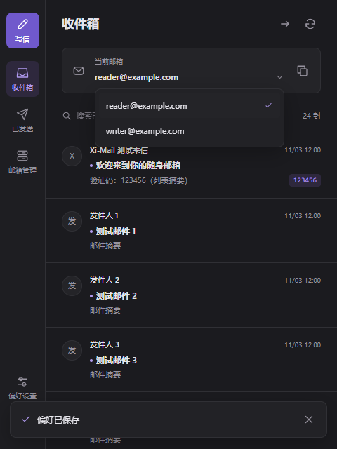

<div align="center">


# Xi-Mail

**Self-hosted mail service built entirely on Cloudflare**

A fork of [cloud-mail](https://github.com/eoao/cloud-mail) with a full UI redesign and a growing feature set

[](https://github.com/PastKing/xi-mail/releases)
[](LICENSE)
[](https://github.com/PastKing/xi-mail/stargazers)
[](https://t.me/pk_oa)

[简体中文](README.md) | [English](README-en.md)

</div>

With a single domain hosted on Cloudflare you can deploy a complete mail platform — multi-account, multi-domain, tiered permissions — at no cost. It runs on Workers + D1 + KV + R2, with no servers to maintain.

---

## 📸 Preview

| Login template | Floating Island |
|:---:|:---:|
|  |  |
| **Domain management** | **Analytics** |
|  |  |

More templates, layouts and feature screenshots: [Screenshots](doc/PREVIEW-en.md).

## 🔑 Live demo

Try it at [mail.azx.us](https://mail.azx.us) using invite code `viewUser` (limited to the `@nlfree.me` suffix). For preview only — do not store real mail there.

---

## ✨ Highlights

**Interface**
Six login templates: Minimal, Editorial, Night Post, Composition, Open Letter and Postal Passport, with automatic compatibility for retired templates. Six color themes and four post-login layouts (full sidebar, icon-only sidebar, top navigation and Floating Island) are switchable from system settings and persisted server-side. Floating Island uses a detached rail on desktop and a bottom dock on mobile. Icons are unified on `mingcute`; the UI ships in English and Chinese, and the language preference follows the account across devices.

**Third-party sign-in**
System Settings includes a dedicated OAuth Integration page ordered as NodeLoc, Telegram and LinuxDo. Administrators configure application credentials and, for LinuxDo and NodeLoc, a minimum trust level. Users register a mailbox through the existing invitation-code rules, then connect or disconnect providers in Personal Settings. OAuth only signs in to an already connected mailbox and never creates an account automatically. Enabled providers appear side by side on the login page. Reconfiguring an application does not delete existing connections.

Callback URLs are generated automatically and displayed as read-only: `/oauth/linuxdo`, `/oauth/telegram` and `/oauth/nodeloc`. Register the corresponding URL in [LinuxDo Connect](https://connect.linux.do/), Login Widget in [BotFather](https://t.me/BotFather), or [NodeLoc applications](https://www.nodeloc.com/oauth-provider/applications). Telegram uses OIDC authorization codes with PKCE and server-side ID token signature verification. NodeLoc requests only `openid profile`, without email access. Client secrets stay on the server; leaving the field blank preserves the existing secret. Worker environment variables remain a fallback when no administrator configuration has been saved.

**Users and accounts**
User IDs are random alphanumeric strings and can be copied with one click. Each user can hold up to 100 mailbox accounts, and a deleted mailbox can be recreated. Mailboxes can be transferred to another user along with all their mail, subject to the recipient's approval. Roles carry a `level` field, so a user can only issue invite codes for roles below their own.

**Delivery control**
Sender-domain filtering runs in either blacklist or whitelist mode; in whitelist mode only authorized providers are accepted. Both the SMTP envelope sender and the header `From` address are checked, with subdomain matching. There is also an address keyword blacklist and configurable invite-code hints and links (separately for English and Chinese).

**Domain management**
No need to edit `wrangler.toml` — add, remove, enable and disable domains directly in system settings, and reorder them by dragging or with the up/down buttons. That order is exactly the order of mailbox suffixes on the registration page, with the first entry as the default.

**Deployment shapes**
Deploy the frontend and Worker together, or run `build:standalone` to produce a static frontend for CF Pages, Vercel or any static host. The frontend can connect to several Worker instances at once and aggregate their data, and `mail-worker-sub/` provides a lightweight sub-worker template that only receives mail and serves the API — no user system, no pages.

**Admin API**
Generate a global API token and query mail without logging in via the `x-admin-auth` header:

```http
GET /api/admin/mails?limit=20&offset=0&address=user@domain.com
x-admin-auth: <your-token>
```

---

## 🧩 Browser extension

A companion Chrome extension for reading mail, copying verification codes, writing mail and managing mailboxes without opening the website.

| Inbox | Reading | Dark · switch mailbox |
|:---:|:---:|:---:|
|  |  |  |

- Inbox, sent, compose and reply; verification codes shown in the list with one-click copy
- Switch, create and delete mailboxes; multiple accounts stay separate
- Draggable floating button on the right edge of any page that opens the full mailbox window
- New mail notifications; light / dark / follow system
- Passwords are never stored and the login token is encrypted locally; mail bodies render in a sandbox with remote images blocked

**Install**: download [`doc/plug-in/chrome-plug.zip`](doc/plug-in/chrome-plug.zip) and unzip it → open `chrome://extensions` and turn on Developer mode → click "Load unpacked" and pick the unzipped folder → click the Xi-Mail toolbar icon and sign in with your site URL (e.g. `https://mail.example.com`), email and password.

Requires Chrome 120 or later. Attachments cannot be sent yet; actions that need a CAPTCHA (such as some mailbox creation) should be done on the website.

---

## 🚀 Deployment

Prerequisites: Node.js ≥ 20, `npx wrangler login` completed, and a domain hosted on Cloudflare with Email Routing enabled.

```bash
git clone https://github.com/PastKing/xi-mail.git
cd xi-mail/mail-worker && npm install

# Create Cloudflare resources and note the returned IDs
npx wrangler d1 create xi-mail
npx wrangler kv namespace create kv
npx wrangler r2 bucket create xi-mail

# Fill in the configuration
cp wrangler.example.toml wrangler.toml

# Build the frontend and deploy
cd ../mail-view && npm install && npm run build
cd ../mail-worker && npx wrangler deploy
```

After deploying, visit `https://your-worker.workers.dev/api/init/<JWT_SECRET>` to initialize or migrate the database schema.

Key `wrangler.toml` fields:

```toml
[vars]
domain      = ["mail.example.com"]   # Domain list; may be left empty once domains are managed in system settings
admin       = "admin@example.com"    # Admin address, immutable after initialization
jwt_secret  = "your-secret"          # JWT secret, at least 32 random characters
```

### Standalone frontend

```bash
cd mail-view
VITE_BASE_URL=https://your-worker.workers.dev/api npm run build:standalone
# Deploy dist/ to CF Pages, Vercel or any static host
```

Without `VITE_BASE_URL`, the first visit redirects to `/setup` so the Worker address can be entered manually.

For a more detailed walkthrough, see the upstream [cloud-mail docs](https://github.com/eoao/cloud-mail).

---

## 📋 Release history

| Version | Summary |
|---------|---------|
| **v3.6.0** | Refreshed login templates and brand icons, provider sign-in, account connections and authorization status pages, smaller compose button |
| **v3.5.x** | Browser extension, QueenSMTP sending, sub-workers, sessions and code extraction |
| **v3.4.x** | Floating Island navigation and login templates |
| **v3.3.x** | Sender whitelist mode |
| **v3.2.x** | Sender-domain blocking |
| **v3.0 – 3.1** | Frontend/backend split, multi-server, sub-worker |
| **v2.0.0** | Appearance template system |

Full changelog: [Releases](https://github.com/PastKing/xi-mail/releases).

---

## 🛠️ Stack and layout

Backend: Cloudflare Workers with Hono, Drizzle ORM and D1 / KV / R2. Frontend: Vue 3, Vite, Element Plus, Pinia, TailwindCSS 4 and vue-i18n.

```
xi-mail/
├── mail-worker/       # Main worker: API, business logic, auth, migrations
├── mail-view/         # Vue 3 frontend: layout, pages, login templates, themes, i18n
├── mail-worker-sub/   # Sub-worker template: mail receiving + API, with its own docs
└── doc/images/        # Screenshots
```

---

## 💬 Community and support

[GitHub](https://github.com/PastKing/xi-mail) · [Telegram @pk_oa](https://t.me/pk_oa) · upstream [eoao/cloud-mail](https://github.com/eoao/cloud-mail)

If this project helps you, USDT donations are welcome:

| Network | Address |
|---------|---------|
| BEP20 (BSC) | `0x555390f5c07cf76cc344f42612196e8669e3586b` |
| TRC20 (TRON) | `TVqK4thJCsaaWvp1Dah9F5CFZ1iqw75f4G` |

---

## 📄 License

[MIT License](LICENSE). The upstream project [eoao/cloud-mail](https://github.com/eoao/cloud-mail) is also MIT licensed, and its original copyright notice is preserved here.
