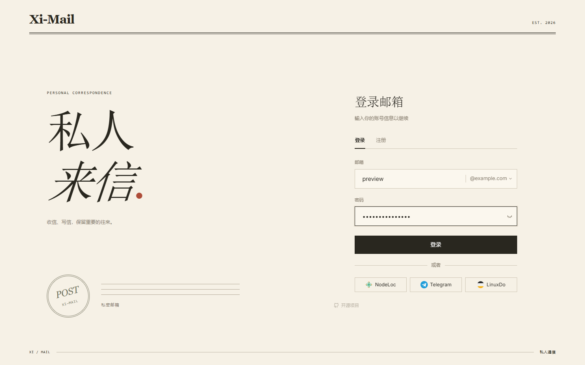
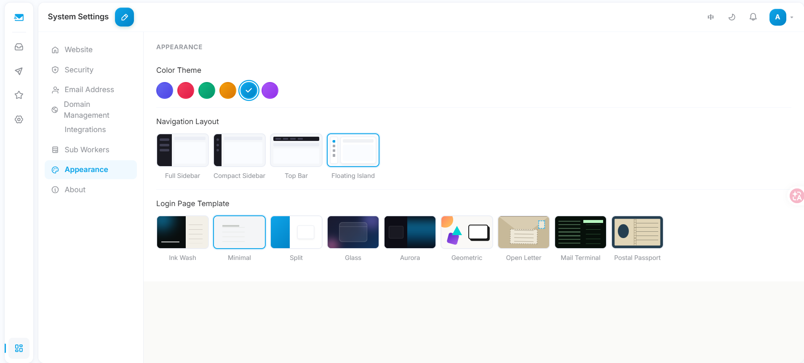
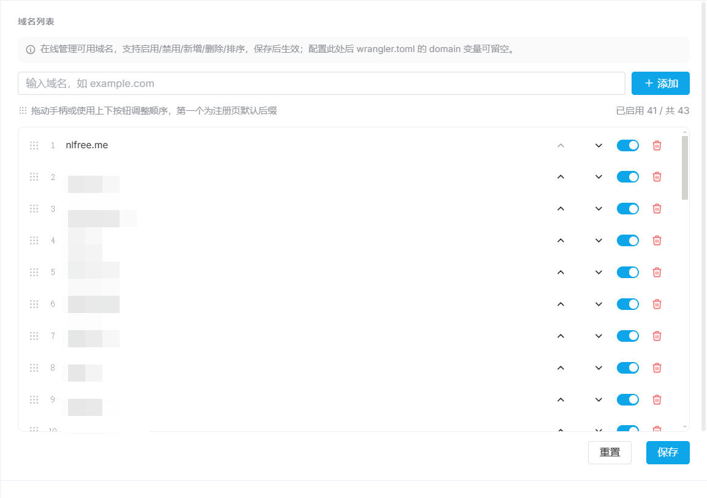
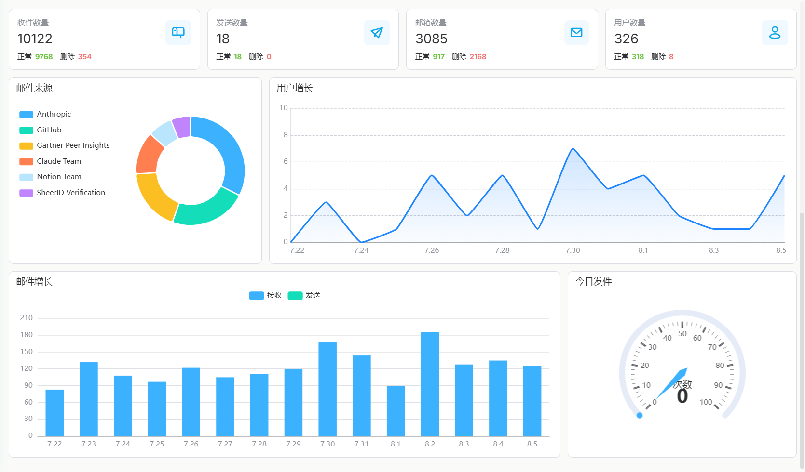
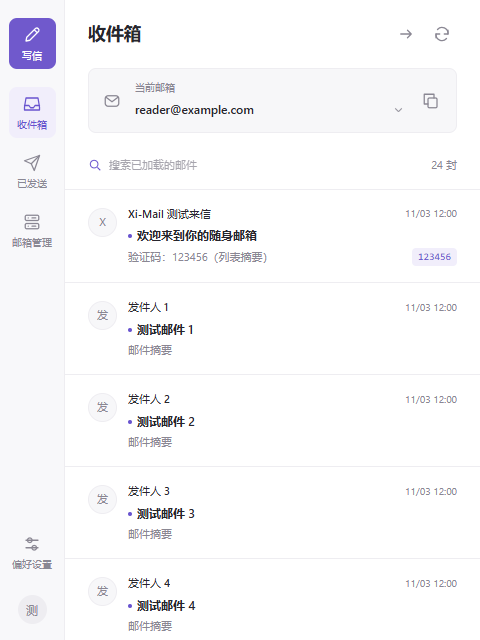
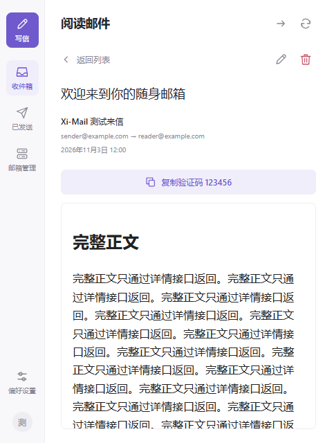
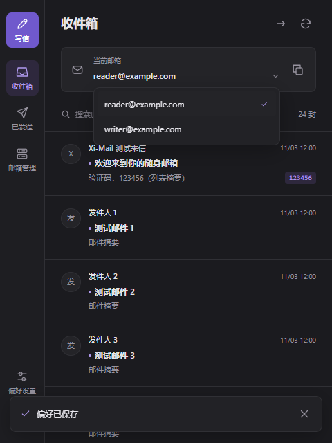

<div align="center">


# Xi-Mail

**基於 Cloudflare 的自架郵件服務**

衍生自 [cloud-mail](https://github.com/maillab/cloud-mail)，重新設計介面並持續擴充功能

[](https://github.com/PastKing/xi-mail/releases)
[](LICENSE)
[](https://github.com/PastKing/xi-mail/stargazers)
[](https://t.me/pk_oa)

[简体中文](README.md) | [繁體中文](README-zh-TW.md) | [English](README-en.md)

</div>

只需一個託管於 Cloudflare 的網域，即可部署支援多帳號、多網域與分級權限的郵件平台。服務運行於 Workers、D1、KV 和 R2，無須自行維護伺服器。

---

## 📸 預覽

| 登入範本 | 浮島導覽 |
|:---:|:---:|
|  |  |
| **網域管理** | **資料分析** |
|  |  |

更多範本、版面與功能截圖請見 [介面預覽](doc/PREVIEW.md)（簡體中文）。

## 🔑 線上體驗

體驗站：[mail.azx.us](https://mail.azx.us)。使用註冊碼 `viewUser` 註冊。

---

## ✨ 主要特色

- **郵件收發**：多信箱管理、郵件搜尋、撰寫與回覆、驗證碼擷取；相容 Resend、QueenSMTP、SendFlare。
- **網域與篩選**：在後台管理多個網域，支援寄件者允許清單、封鎖清單及關鍵字篩選。
- **使用者與權限**：角色分級、註冊碼註冊、信箱移轉、限時收件匣分享及工作階段管理。
- **第三方登入**：支援 NodeLoc、Telegram、Discord、GitHub、Google、LinuxDo，綁定既有信箱後即可登入。
- **介面自訂**：6 套登入範本、6 套主題色與 4 種導覽版面，支援行動裝置與中英文介面。
- **彈性部署**：支援前後端一體部署、獨立前端、多個 Worker 執行個體與收信子 Worker。
- **API 整合**：透過全域 API Token 查詢郵件，方便串接其他工具。

設定方式與請求範例請見 [OAuth 與 API 整合說明](doc/INTEGRATIONS-zh-TW.md)。

---

## 🧩 瀏覽器擴充功能

搭配 Chrome 擴充功能，無須開啟網站即可收信、複製驗證碼、撰寫郵件及管理信箱。

| 收件匣 | 閱讀郵件 | 深色模式與信箱切換 |
|:---:|:---:|:---:|
|  |  |  |

- 支援收件匣、寄件備份、撰寫與回覆，郵件清單直接顯示驗證碼並可一鍵複製
- 支援切換、新增及刪除信箱，多個登入帳號互不干擾
- 任意網頁右側提供可拖曳的懸浮入口，展開後為完整信箱視窗
- 支援新郵件通知，以及淺色、深色或跟隨系統外觀
- 不儲存密碼，登入憑證在本機加密保存；郵件內文在沙箱中顯示，預設不載入遠端圖片

**安裝方式**：下載並解壓縮 [`chrome-plug.zip`](doc/plug-in/chrome-plug.zip) → 開啟 `chrome://extensions` 並啟用「開發人員模式」→ 選擇「載入未封裝項目」及解壓縮後的資料夾 → 點選工具列上的 Xi-Mail 圖示，輸入站點網址（例如 `https://mail.example.com`）、電子郵件地址與密碼。

需要 Chrome 120 以上版本。目前不支援寄送附件；需要人機驗證的操作請至網頁版完成。

---

## 🚀 部署

前置需求：Node.js ≥ 20、已執行 `npx wrangler login`，以及一個託管於 Cloudflare 並啟用 Email Routing 的網域。

```bash
git clone https://github.com/PastKing/xi-mail.git
cd xi-mail/mail-worker && npm install

# 建立 Cloudflare 資源並記錄回傳的 ID
npx wrangler d1 create xi-mail
npx wrangler kv namespace create kv
npx wrangler r2 bucket create xi-mail

# 填寫設定
cp wrangler.example.toml wrangler.toml

# 分別輸入兩個獨立隨機密鑰，至少 32 位
npx wrangler secret put jwt_secret
npx wrangler secret put init_secret

# 建置前端並部署
cd ../mail-view && npm install && npm run build
cd ../mail-worker && npx wrangler deploy
```

部署後造訪 `https://your-worker.workers.dev/api/init/<INIT_SECRET>`，初始化或遷移資料表。登入簽章與初始化使用獨立的 Cloudflare Secret，請勿沿用範例密鑰。

`wrangler.toml` 主要欄位：

```toml
[vars]
domain      = ["mail.example.com"]   # 改用系統設定管理網域後可留空
admin       = "admin@example.com"    # 管理員信箱，初始化後無法變更
```

### 獨立部署前端

```bash
cd mail-view
VITE_BASE_URL=https://your-worker.workers.dev/api npm run build:standalone
# 將 dist/ 部署至 Cloudflare Pages、Vercel 等靜態託管服務
```

未設定 `VITE_BASE_URL` 時，首次開啟會跳轉至 `/setup`，引導填寫 Worker 網址。

詳細部署方式可參考上游專案的 [cloud-mail 文件](https://github.com/maillab/cloud-mail)。

---

## 🛠️ 技術與目錄結構

後端採用 Cloudflare Workers、Hono、Drizzle ORM、D1、KV 與 R2；前端採用 Vue 3、Vite、Element Plus、Pinia、TailwindCSS 4 與 vue-i18n。

```text
xi-mail/
├── mail-worker/       # 主 Worker：API、業務邏輯、驗證與資料庫遷移
├── mail-view/         # Vue 3 前端：版面、頁面、登入範本、主題與多語言
├── mail-worker-sub/   # 子 Worker 範本：收信與 API，附部署文件
└── doc/images/        # 介面截圖
```

---

## 💬 社群與支援

[GitHub](https://github.com/PastKing/xi-mail) · [Telegram @pk_oa](https://t.me/pk_oa) · 上游專案 [maillab/cloud-mail](https://github.com/maillab/cloud-mail)

若本專案對你有幫助，歡迎捐贈 USDT 支持開發：

| 網路 | 地址 |
|---|---|
| BEP20 (BSC) | `0x555390f5c07cf76cc344f42612196e8669e3586b` |
| TRC20 (TRON) | `TVqK4thJCsaaWvp1Dah9F5CFZ1iqw75f4G` |

---

## 📄 授權

採用 [MIT License](LICENSE)。上游專案 [maillab/cloud-mail](https://github.com/maillab/cloud-mail) 同樣採用 MIT 授權，本專案保留其原始版權聲明。
