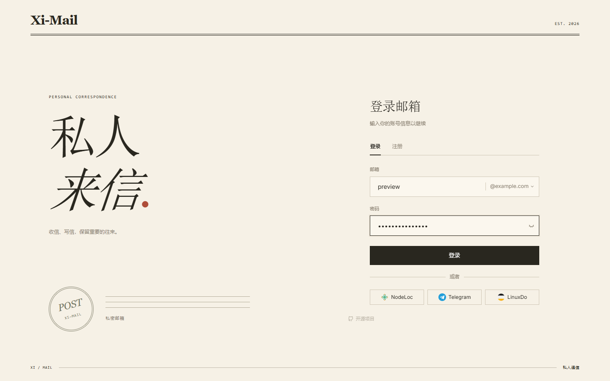
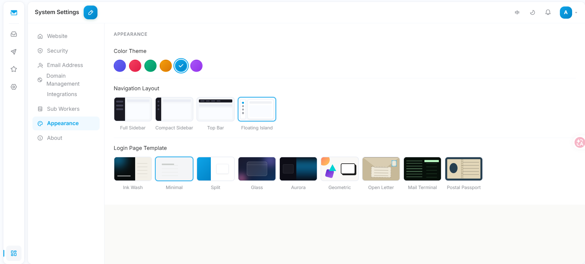
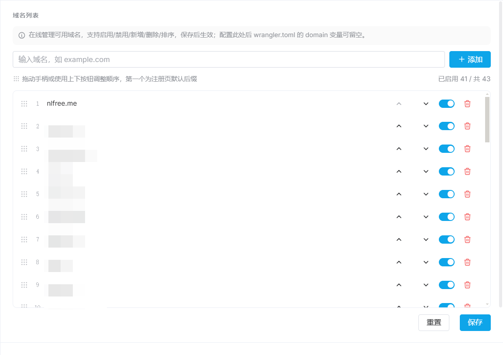
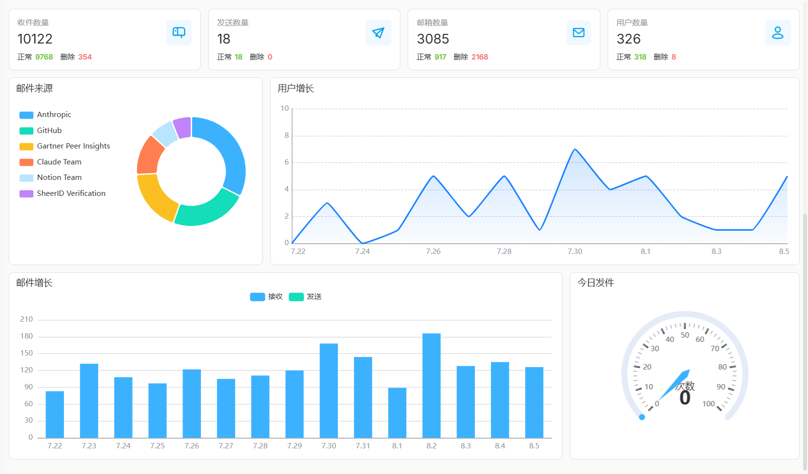
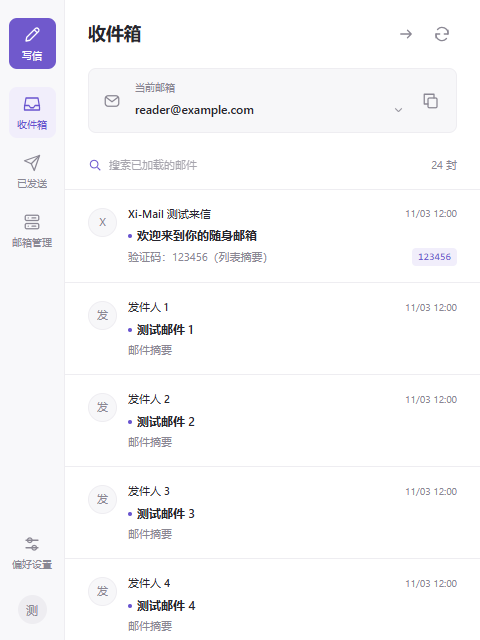
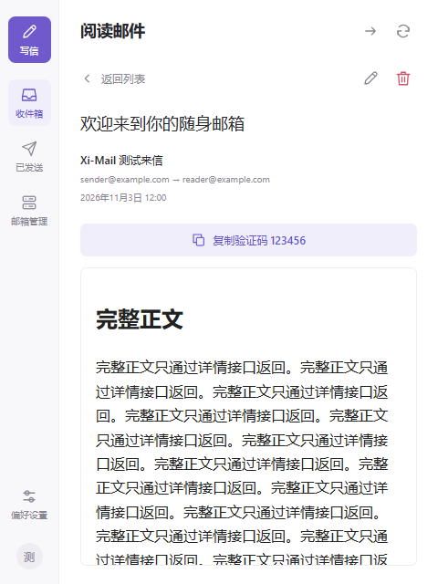
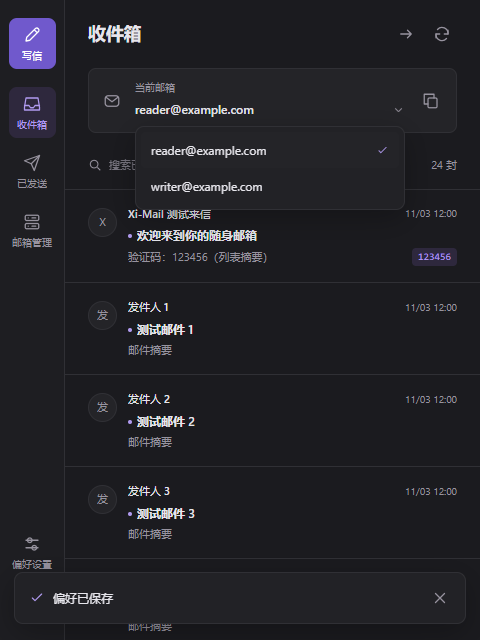

<div align="center">


# Xi-Mail

**基於 Cloudflare 的自架郵件服務**

衍生自 [cloud-mail](https://github.com/maillab/cloud-mail)，重新設計介面並持續擴充功能

[](https://github.com/PastKing/xi-mail/releases)
[](LICENSE)
[](https://github.com/PastKing/xi-mail/stargazers)
[](https://t.me/pk_oa)

[简体中文](README.md) | [繁體中文](README-zh-TW.md) | [English](README-en.md)

</div>

只需一個託管於 Cloudflare 的網域，即可部署支援多帳號、多網域與分級權限的郵件平台。服務運行於 Workers、D1、KV 和 R2，無須自行維護伺服器。

---

## 📸 預覽

| 登入範本 | 浮島導覽 |
|:---:|:---:|
|  |  |
| **網域管理** | **資料分析** |
|  |  |

更多介面截圖請見[線上預覽](https://xi-mail-docs.azx.us/zh-TW/guide/preview)。

## ✨ 主要特色

- **郵件收發**：多信箱管理、郵件搜尋、撰寫與回覆、驗證碼擷取；相容 Resend、QueenSMTP、SendFlare 與 Cloudflare Email。
- **網域與篩選**：在後台管理多個網域，支援寄件者允許清單、封鎖清單及關鍵字篩選。
- **使用者與權限**：角色分級、註冊碼註冊、信箱移轉、限時收件匣分享及工作階段管理。
- **第三方登入**：支援 NodeLoc、Telegram、Discord、GitHub、Google、LinuxDo，綁定既有信箱後即可登入。
- **介面自訂**：6 套登入範本、6 套主題色與 4 種導覽版面，支援行動裝置與中英文介面。
- **彈性部署**：支援前後端一體部署、獨立前端、多個 Worker 執行個體與收信子 Worker。
- **API 整合**：透過全域 API Token 查詢郵件，方便串接其他工具。

---

## 🧩 瀏覽器擴充功能

搭配 Chrome 擴充功能，可在瀏覽器中閱讀郵件、複製驗證碼及管理信箱。

| 收件匣 | 閱讀郵件 | 深色模式與信箱切換 |
|:---:|:---:|:---:|
|  |  |  |

- 收件匣、寄件備份、撰寫與回覆，支援一鍵複製驗證碼
- 信箱管理、多帳號切換與新郵件通知
- 支援懸浮視窗及淺色、深色外觀

**安裝方式**：下載[瀏覽器擴充功能](doc/plug-in/chrome-plug.zip)並解壓縮，在 `chrome://extensions` 啟用「開發人員模式」並載入資料夾，再使用自己的站點網址與帳號登入。

需要 Chrome 120 以上版本。

---

## 🚀 部署

請參閱 [Xi-Mail 線上文件](https://xi-mail-docs.azx.us/guide/deploy)，內含 Cloudflare 圖形介面部署、命令列部署、首次初始化、收信網域與後續更新教程。

---

## 🛠️ 技術與目錄結構

後端採用 Cloudflare Workers、Hono、Drizzle ORM、D1、KV 與 R2；前端採用 Vue 3、Vite、Element Plus、Pinia、TailwindCSS 4 與 vue-i18n。

```text
xi-mail/
├── wrangler.toml      # Git 介面部署：建置命令已內建，控制台不用填 Path
├── mail-worker/       # 主 Worker：API、業務邏輯、驗證與資料庫遷移
├── mail-view/         # Vue 3 前端：版面、頁面、登入範本、主題與多語言
├── mail-worker-sub/   # 子 Worker 範本：收信與 API，附部署文件
└── doc/images/        # 介面截圖
```

---

## 💬 社群與支援

[GitHub](https://github.com/PastKing/xi-mail) · [Telegram @pk_oa](https://t.me/pk_oa) · 上游專案 [maillab/cloud-mail](https://github.com/maillab/cloud-mail)

若本專案對你有幫助，歡迎捐贈 USDT 支持開發：

| 網路 | 地址 |
|---|---|
| BEP20 (BSC) | `0x555390f5c07cf76cc344f42612196e8669e3586b` |
| TRC20 (TRON) | `TVqK4thJCsaaWvp1Dah9F5CFZ1iqw75f4G` |

---

## 📄 授權

採用 [MIT License](LICENSE)。上游專案 [maillab/cloud-mail](https://github.com/maillab/cloud-mail) 同樣採用 MIT 授權，本專案保留其原始版權聲明。
