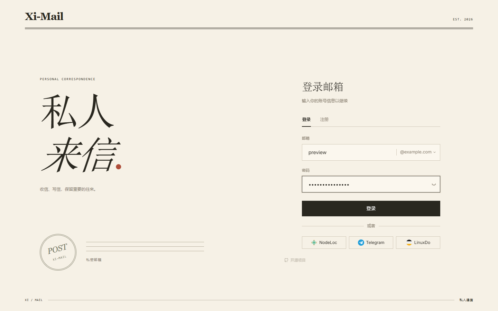
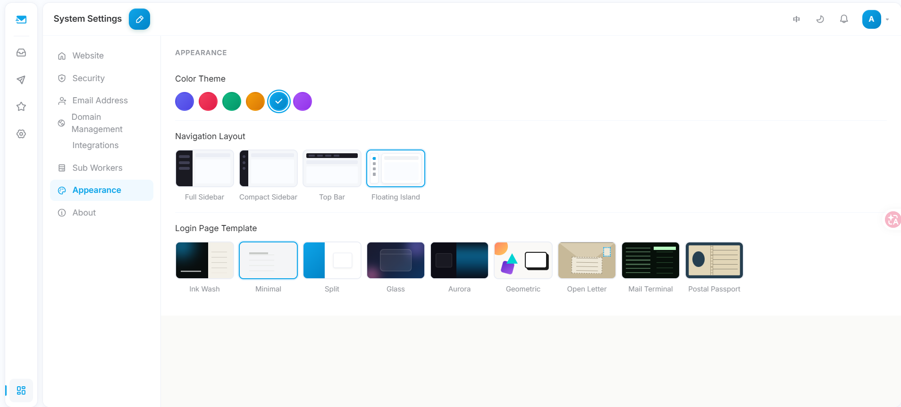
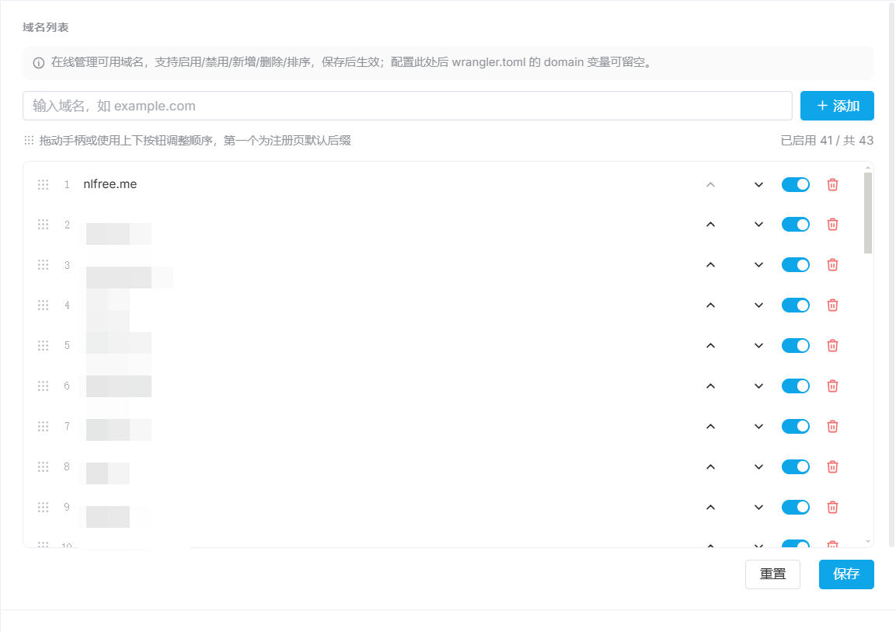
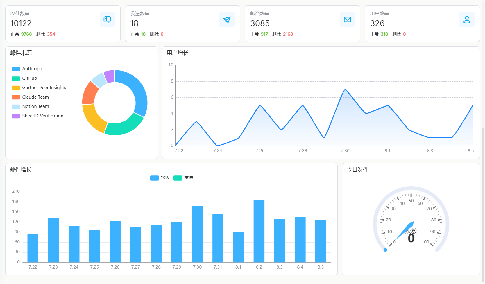
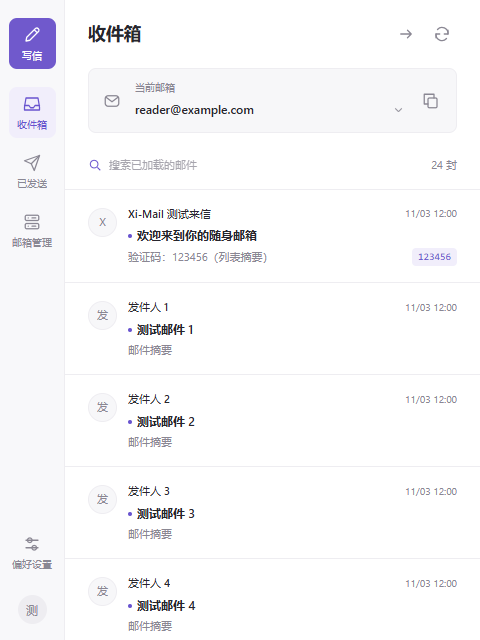
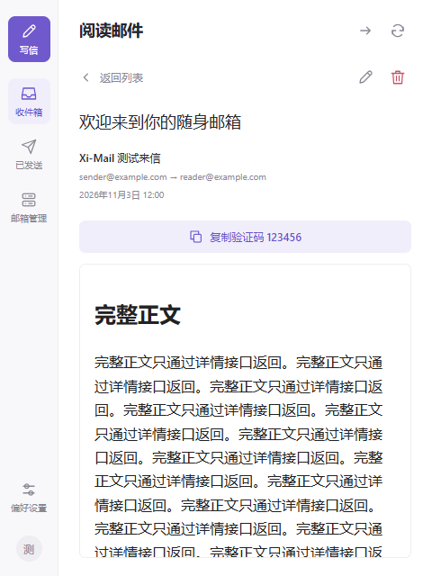
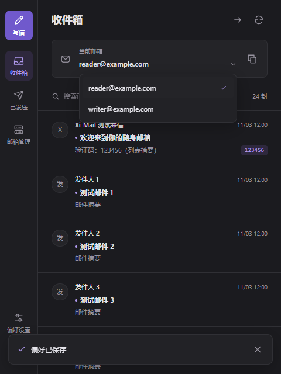

<div align="center">


# Xi-Mail

**基于 Cloudflare 全家桶的自托管邮箱服务**

二次开发自 [cloud-mail](https://github.com/maillab/cloud-mail)，UI 全面重设计，功能持续扩展

[](https://github.com/PastKing/xi-mail/releases)
[](LICENSE)
[](https://github.com/PastKing/xi-mail/stargazers)
[](https://t.me/pk_oa)

[简体中文](README.md) | [繁體中文](README-zh-TW.md) | [English](README-en.md)

</div>

只需一个托管在 Cloudflare 的域名，即可免费部署一套支持多账户、多域名、层级权限的完整邮箱平台。运行在 Workers + D1 + KV + R2 之上，无服务器成本。

---

## 📸 预览

| 登录模板 | 浮岛导航 |
|:---:|:---:|
|  |  |
| **域名管理** | **数据分析** |
|  |  |

更多模板、布局与功能截图见 [界面预览](doc/PREVIEW.md)。

## 🔑 在线体验

演示站 [mail.azx.us](https://mail.azx.us)，用注册码 `viewUser` 注册（仅限 `@nlfree.me` 后缀）。仅供预览，请勿存放真实邮件。

---

## ✨ 主要特性

- **邮件收发**：多邮箱管理、邮件搜索、写信回复与验证码提取；兼容 Resend、QueenSMTP、SendFlare。
- **域名与过滤**：后台管理多个域名，支持发件人黑白名单和关键词过滤。
- **用户与权限**：角色分级、注册码注册、邮箱转移、限时收件箱分享与会话管理。
- **第三方登录**：支持 NodeLoc、Telegram、Discord、GitHub、Google、LinuxDo，绑定已有邮箱后即可登录。
- **界面定制**：6 套登录模板、6 套主题色、4 种导航布局，适配手机与中英文。
- **灵活部署**：支持一体部署、独立前端、多 Worker 实例与收信子 Worker。
- **API 集成**：通过全局 API Token 查询邮件，方便接入其他工具。

配置方法与接口示例见 [OAuth 与 API 集成说明](doc/INTEGRATIONS.md)。

---

## 🧩 浏览器插件

配套的 Chrome 插件，不用打开网页就能收信、看验证码、写信和管理邮箱。

| 收件箱 | 阅读邮件 | 深色 · 切换邮箱 |
|:---:|:---:|:---:|
|  |  |  |

- 收件箱、已发送、写信与回复，邮件列表直接显示验证码，一键复制
- 多个邮箱切换、新建与删除，多账号登录互不干扰
- 任意网页右侧的悬浮入口，可拖动，展开后是完整的邮箱窗口
- 新邮件通知，浅色 / 深色 / 跟随系统
- 密码不保存，登录凭证加密存在本地；邮件正文在沙箱中显示，默认不加载远程图片

**安装**：下载 [`doc/plug-in/chrome-plug.zip`](doc/plug-in/chrome-plug.zip) 并解压 → 打开 `chrome://extensions`，开启「开发者模式」→「加载已解压的扩展程序」，选择解压后的文件夹 → 点击工具栏的 Xi-Mail 图标，填写站点地址（如 `https://mail.example.com`）、邮箱和密码登录。

需要 Chrome 120 及以上。暂不支持发送附件；需要人机验证的操作（如部分新建邮箱）请到网页版完成。

---

## 🚀 部署

前置条件：Node.js ≥ 20、已 `npx wrangler login`、一个托管在 Cloudflare 并开启 Email Routing 的域名。

```bash
git clone https://github.com/PastKing/xi-mail.git
cd xi-mail/mail-worker && npm install

# 创建 Cloudflare 资源，记录输出的 ID
npx wrangler d1 create xi-mail
npx wrangler kv namespace create kv
npx wrangler r2 bucket create xi-mail

# 填写配置
cp wrangler.example.toml wrangler.toml

# 分别输入两个独立随机密钥，至少 32 位
npx wrangler secret put jwt_secret
npx wrangler secret put init_secret

# 构建前端并部署
cd ../mail-view && npm install && npm run build
cd ../mail-worker && npx wrangler deploy
```

部署完成后访问 `https://your-worker.workers.dev/api/init/<INIT_SECRET>` 初始化 / 迁移数据库表结构。登录签名与初始化使用独立的 Cloudflare Secret，不要沿用示例密钥。

`wrangler.toml` 关键字段：

```toml
[vars]
domain      = ["mail.example.com"]   # 域名列表；改用系统设置管理域名后可留空
admin       = "admin@example.com"    # 管理员邮箱，初始化后无法更改
```

### 独立部署前端

```bash
cd mail-view
VITE_BASE_URL=https://your-worker.workers.dev/api npm run build:standalone
# 将 dist/ 部署到 CF Pages / Vercel 等静态托管
```

未配置 `VITE_BASE_URL` 时，首次打开会跳转 `/setup` 引导手动填写 Worker 地址。

更详细的部署说明可参考上游项目 [cloud-mail 文档](https://github.com/maillab/cloud-mail)。

---

## 🛠️ 技术栈与结构

后端 Cloudflare Workers + Hono + Drizzle ORM + D1 / KV / R2；前端 Vue 3 + Vite + Element Plus + Pinia + TailwindCSS 4 + vue-i18n。

```
xi-mail/
├── mail-worker/       # 主 Worker：API、业务逻辑、鉴权、数据库迁移
├── mail-view/         # Vue 3 前端：布局、页面、登录模板、主题色、i18n
├── mail-worker-sub/   # 子 Worker 模板：仅收信 + API，附部署与接口文档
└── doc/images/        # 截图
```

---

## 💬 社区与支持

[GitHub](https://github.com/PastKing/xi-mail) · [Telegram @pk_oa](https://t.me/pk_oa) · 上游项目 [maillab/cloud-mail](https://github.com/maillab/cloud-mail)

若本项目对你有帮助，欢迎捐赠 USDT 支持持续开发：

| 网络 | 地址 |
|------|------|
| BEP20 (BSC) | `0x555390f5c07cf76cc344f42612196e8669e3586b` |
| TRC20 (TRON) | `TVqK4thJCsaaWvp1Dah9F5CFZ1iqw75f4G` |

---

## 📄 许可证

[MIT License](LICENSE)。上游项目 [maillab/cloud-mail](https://github.com/maillab/cloud-mail) 同样采用 MIT 许可证，本项目保留其原始版权声明。
