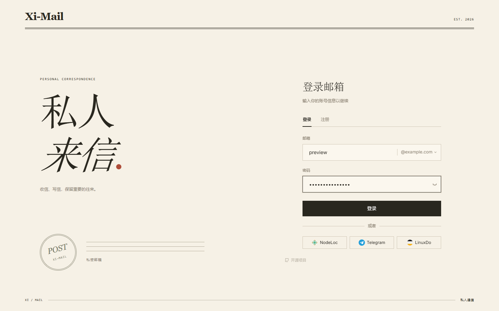
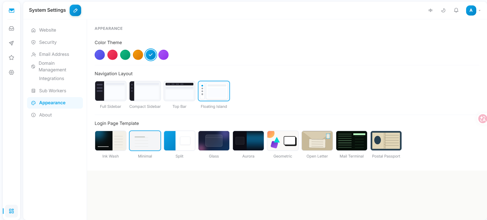
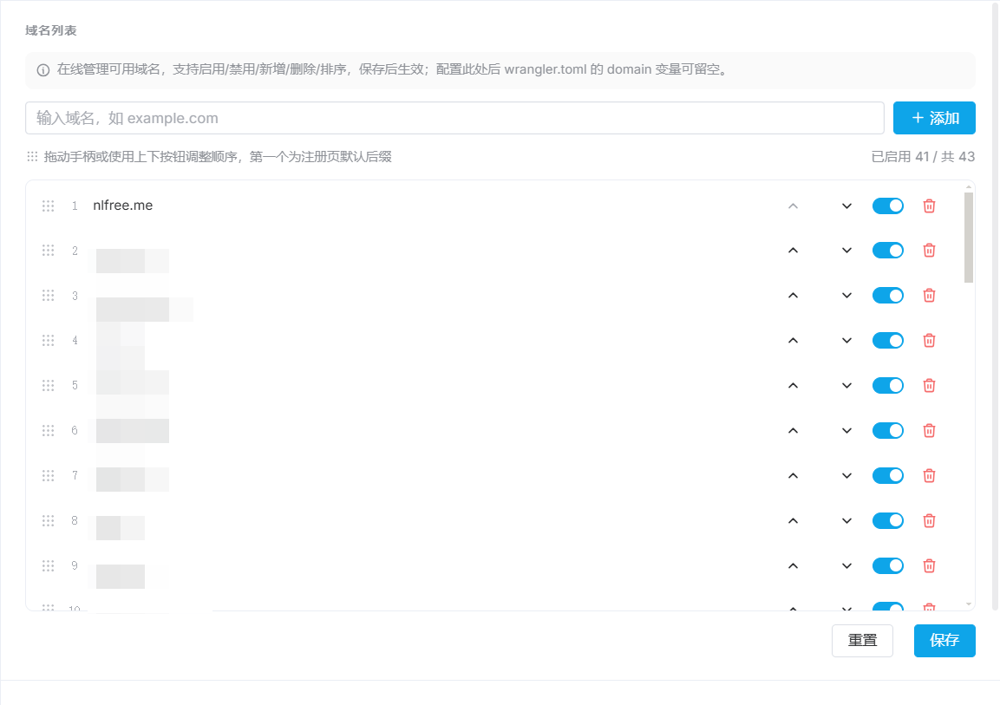
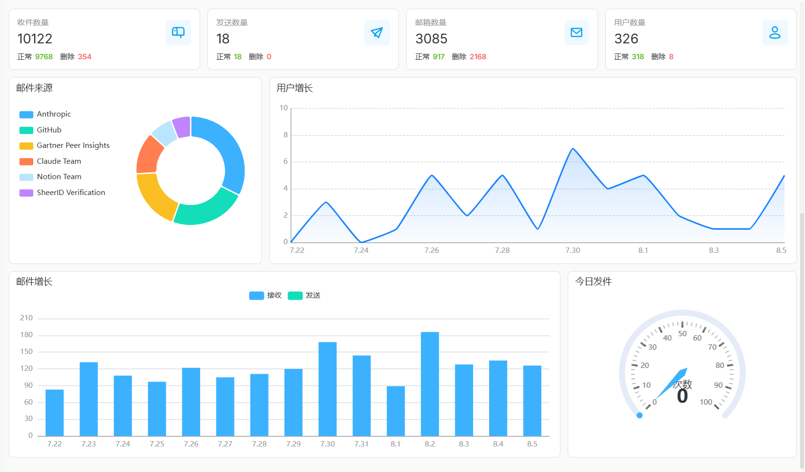
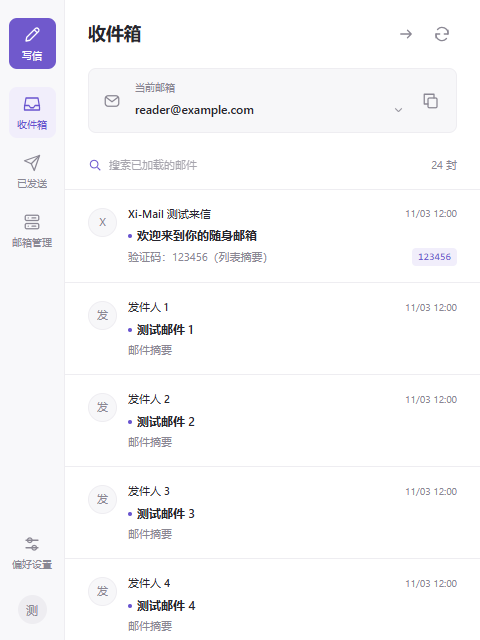
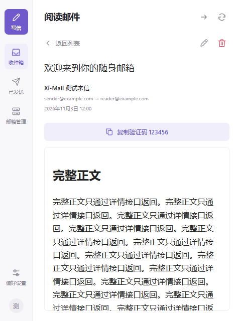
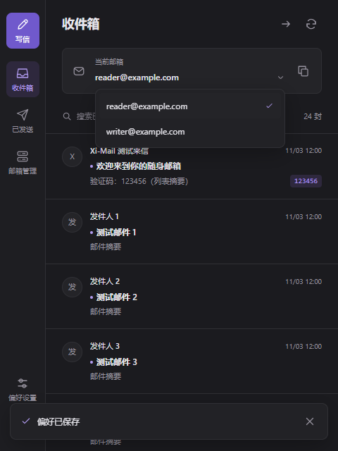

<div align="center">


# Xi-Mail

**基于 Cloudflare 全家桶的自托管邮箱服务**

二次开发自 [cloud-mail](https://github.com/maillab/cloud-mail)，UI 全面重设计，功能持续扩展

[](https://github.com/PastKing/xi-mail/releases)
[](LICENSE)
[](https://github.com/PastKing/xi-mail/stargazers)
[](https://t.me/pk_oa)

[简体中文](README.md) | [繁體中文](README-zh-TW.md) | [English](README-en.md)

</div>

只需一个托管在 Cloudflare 的域名，即可免费部署一套支持多账户、多域名、层级权限的完整邮箱平台。运行在 Workers + D1 + KV + R2 之上，无服务器成本。

---

## 📸 预览

| 登录模板 | 浮岛导航 |
|:---:|:---:|
|  |  |
| **域名管理** | **数据分析** |
|  |  |

更多界面截图见[在线预览](https://xi-mail-docs.azx.us/guide/preview)。

## ✨ 主要特性

- **邮件收发**：多邮箱管理、邮件搜索、写信回复与验证码提取；兼容 Resend、QueenSMTP、SendFlare 和 Cloudflare Email。
- **域名与过滤**：后台管理多个域名，支持发件人黑白名单和关键词过滤。
- **用户与权限**：角色分级、注册码注册、邮箱转移、限时收件箱分享与会话管理。
- **第三方登录**：支持 NodeLoc、Telegram、Discord、GitHub、Google、LinuxDo，绑定已有邮箱后即可登录。
- **界面定制**：6 套登录模板、6 套主题色、4 种导航布局；中文源文案、后台管理多语言，支持独立邮件翻译。
- **灵活部署**：支持一体部署、独立前端、多 Worker 实例与收信子 Worker。
- **API 集成**：通过全局 API Token 查询邮件，方便接入其他工具。

---

## 🧩 浏览器插件

配套 Chrome 插件可在浏览器中查看邮件、复制验证码和管理邮箱。

| 收件箱 | 阅读邮件 | 深色 · 切换邮箱 |
|:---:|:---:|:---:|
|  |  |  |

- 收件、已发送、写信与回复，列表可直接复制验证码
- 多邮箱切换、管理及新邮件提醒
- 支持悬浮窗口、浅色和深色外观

**安装**：下载[浏览器插件](doc/plug-in/chrome-plug.zip)并解压，在 `chrome://extensions` 开启「开发者模式」后加载解压目录，再填写自己的站点地址和账号登录。

需要 Chrome 120 及以上。

---

## 🚀 部署

查看 [Xi-Mail 在线文档](https://xi-mail-docs.azx.us/guide/deploy)，包含 Cloudflare 图形界面部署、命令行部署、首次初始化、域名收信配置和后续更新教程。

---

## 🛠️ 技术栈与结构

后端 Cloudflare Workers + Hono + Drizzle ORM + D1 / KV / R2；前端 Vue 3 + Vite + Element Plus + Pinia + TailwindCSS 4 + vue-i18n。

```
xi-mail/
├── wrangler.toml      # Git 界面部署：构建命令已内置，控制台不用填 Path
├── mail-worker/       # 主 Worker：API、业务逻辑、鉴权、数据库迁移
├── mail-view/         # Vue 3 前端：布局、页面、登录模板、主题色、i18n
├── mail-worker-sub/   # 子 Worker 模板：仅收信 + API，附部署与接口文档
└── doc/images/        # 截图
```

---

## 💬 社区与支持

[GitHub](https://github.com/PastKing/xi-mail) · [Telegram @pk_oa](https://t.me/pk_oa) · 上游项目 [maillab/cloud-mail](https://github.com/maillab/cloud-mail)

若本项目对你有帮助，欢迎捐赠 USDT 支持持续开发：

| 网络 | 地址 |
|------|------|
| BEP20 (BSC) | `0x555390f5c07cf76cc344f42612196e8669e3586b` |
| TRC20 (TRON) | `TVqK4thJCsaaWvp1Dah9F5CFZ1iqw75f4G` |

---

## 📄 许可证

[MIT License](LICENSE)。上游项目 [maillab/cloud-mail](https://github.com/maillab/cloud-mail) 同样采用 MIT 许可证，本项目保留其原始版权声明。
