# Screenshots

Back to [README](../README-en.md) · [中文](PREVIEW.md)

---

## Login templates

| Editorial | Night Post |
|:---:|:---:|
| 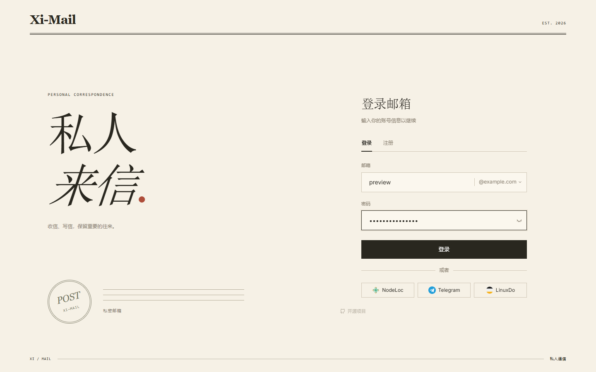 | 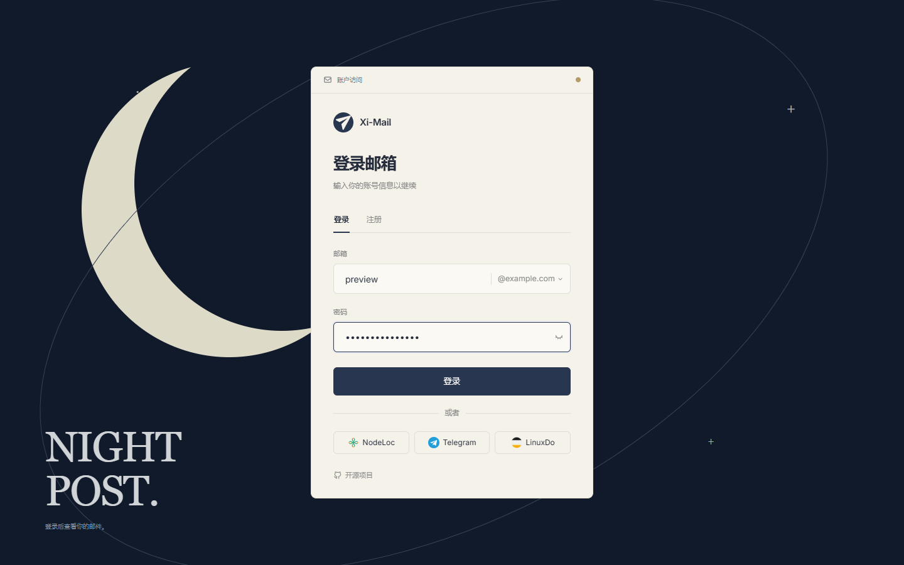 |
| **Composition** | **Minimal (original design)** |
| 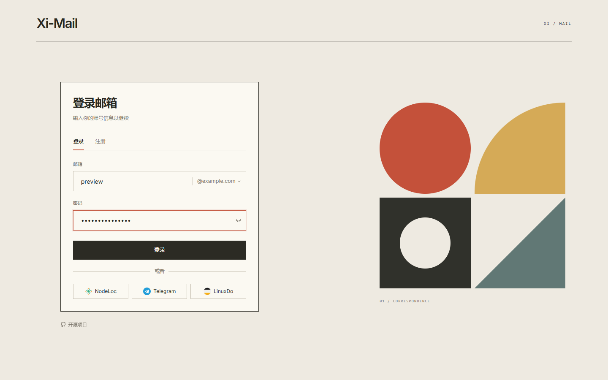 | 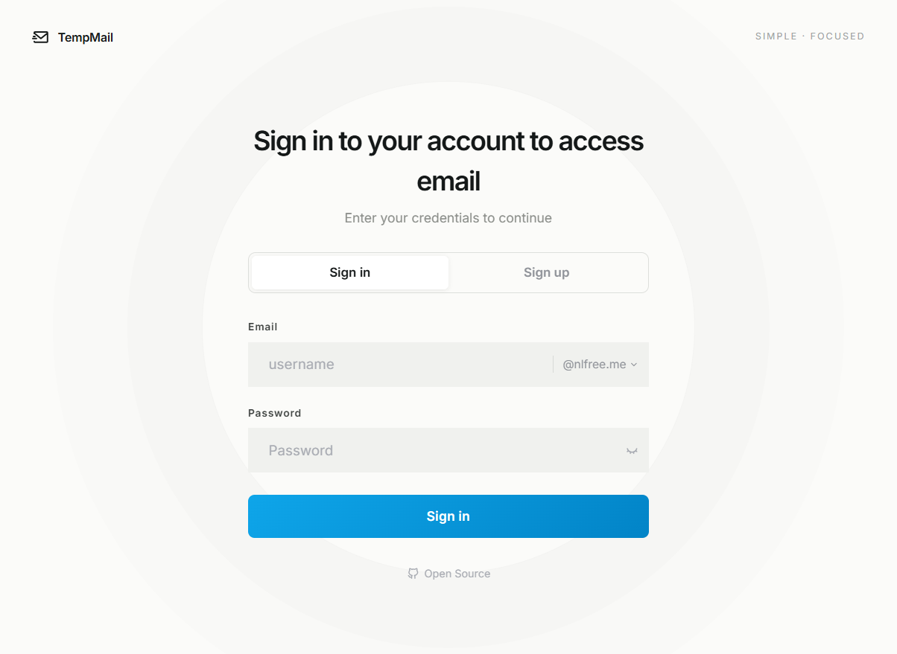 |

Open Letter and Postal Passport are also retained, for six templates in total. Preview them at [mail.azx.us](https://mail.azx.us) under System Settings → Appearance. Retired choices resolve automatically: Ink Wash/Split → Editorial, Glass/Aurora → Night Post, Geometric → Composition, Mail Terminal → Minimal.

---

## Navigation layouts

| Floating Island | Compact Sidebar |
|:---:|:---:|
| 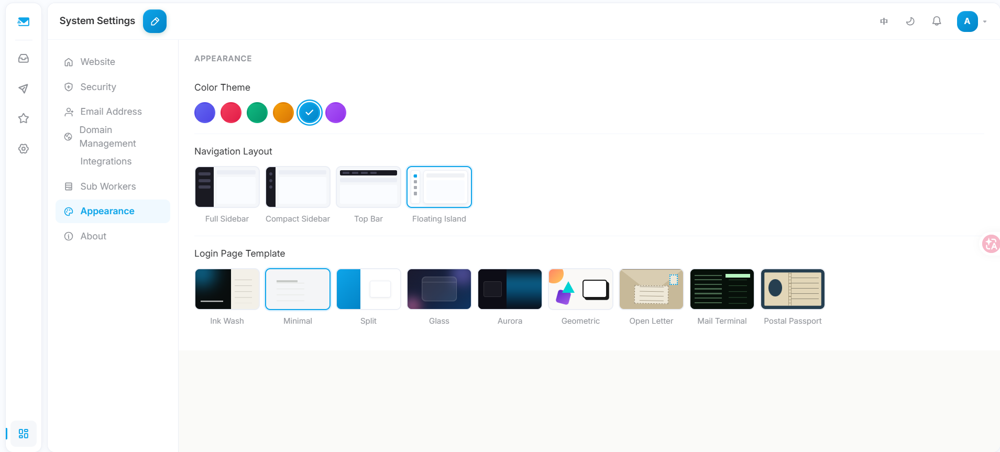 | 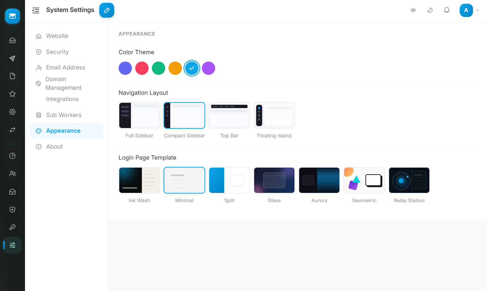 |

Full sidebar and top-bar navigation are also available from Appearance settings.

---

## Features

| OAuth Integration | Connected accounts |
|:---:|:---:|
| 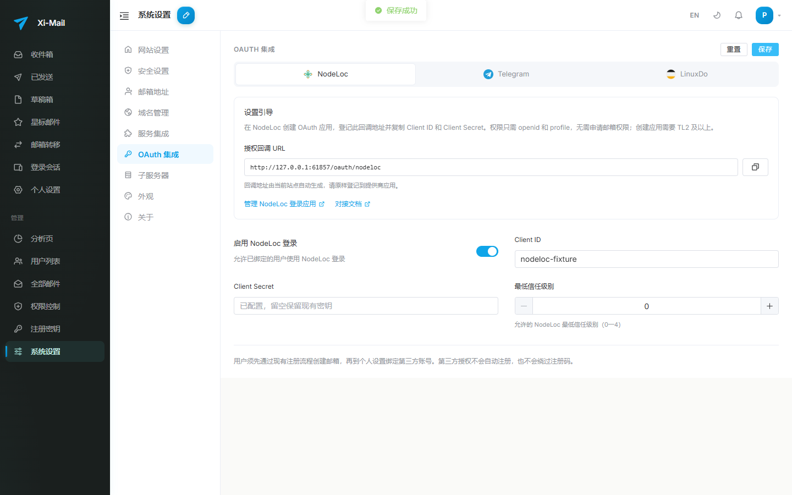 | 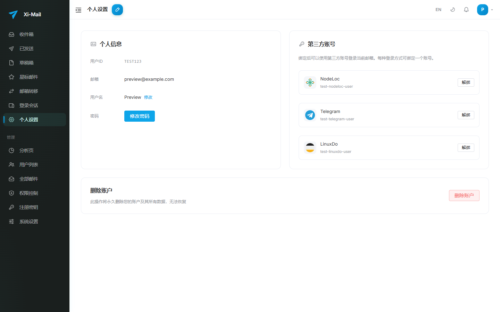 |

| Authorization completed | Authorization incomplete |
|:---:|:---:|
| 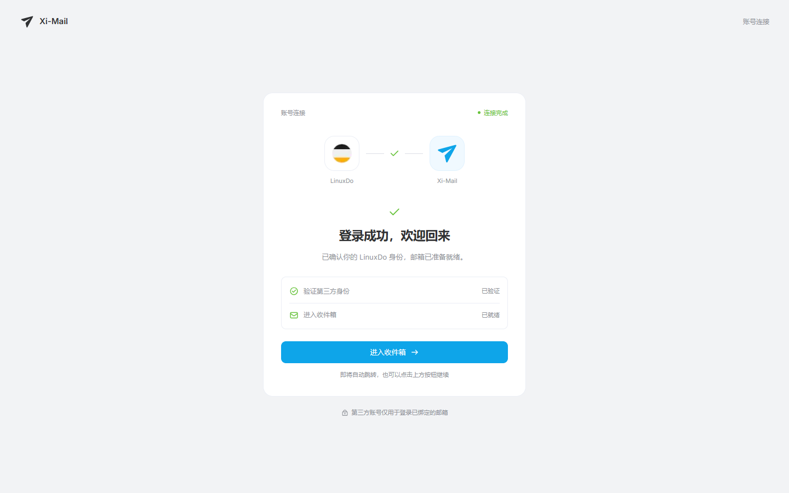 | 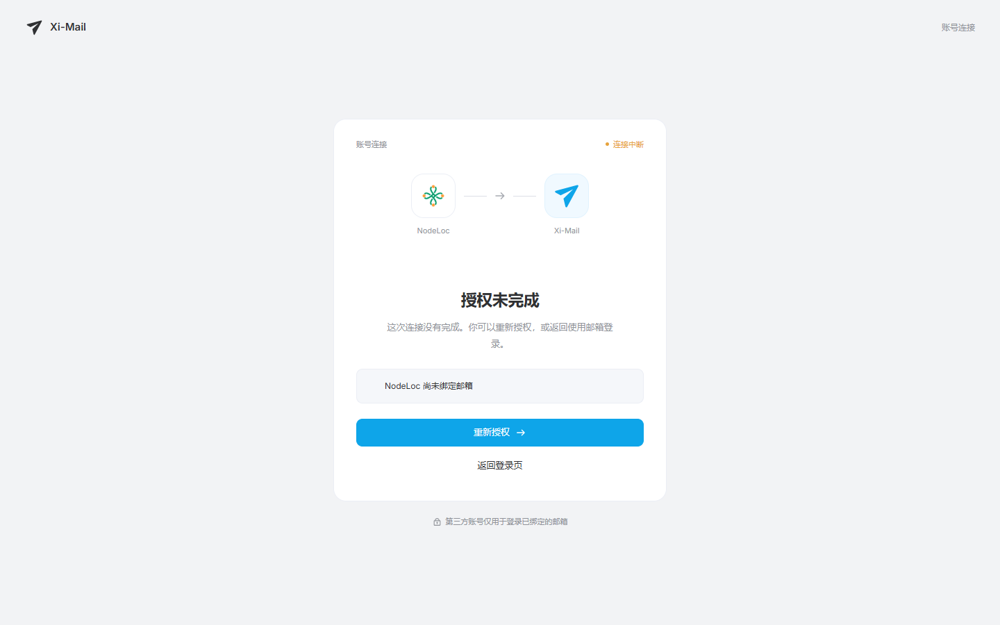 |

| Domain management | Security |
|:---:|:---:|
| 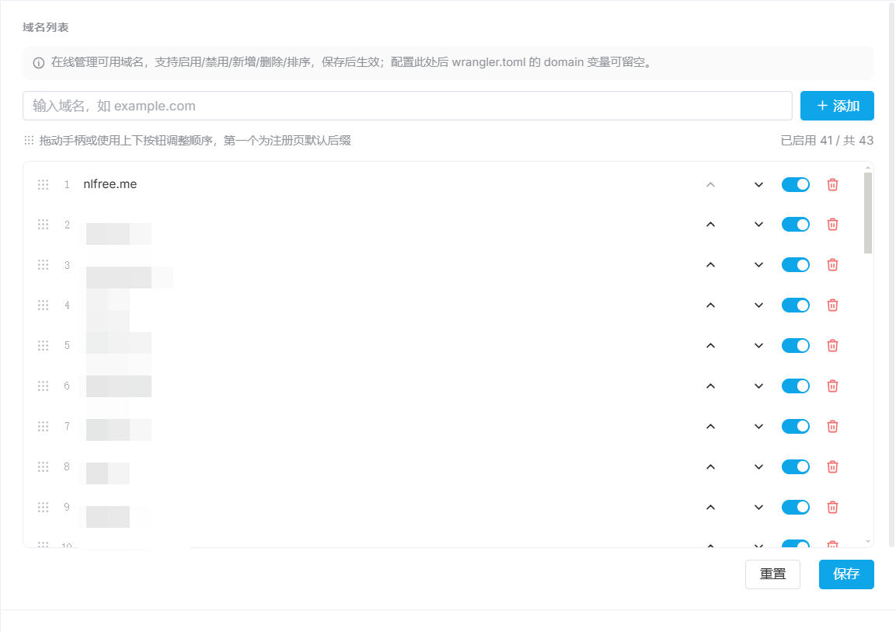 | 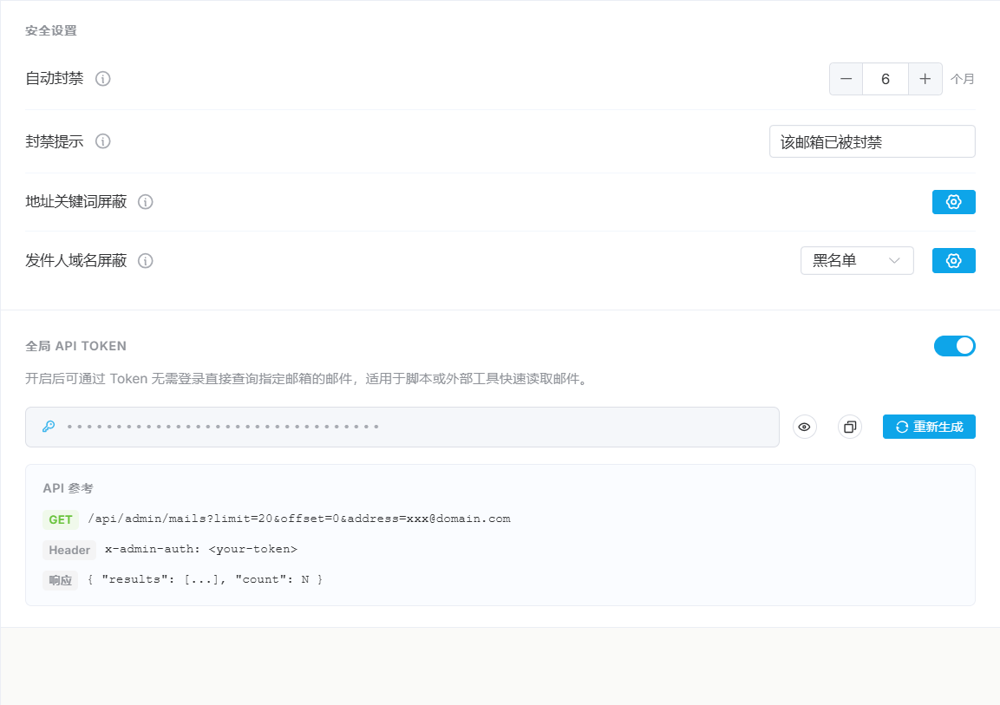 |
| **Analytics** | **Mailbox transfer** |
| 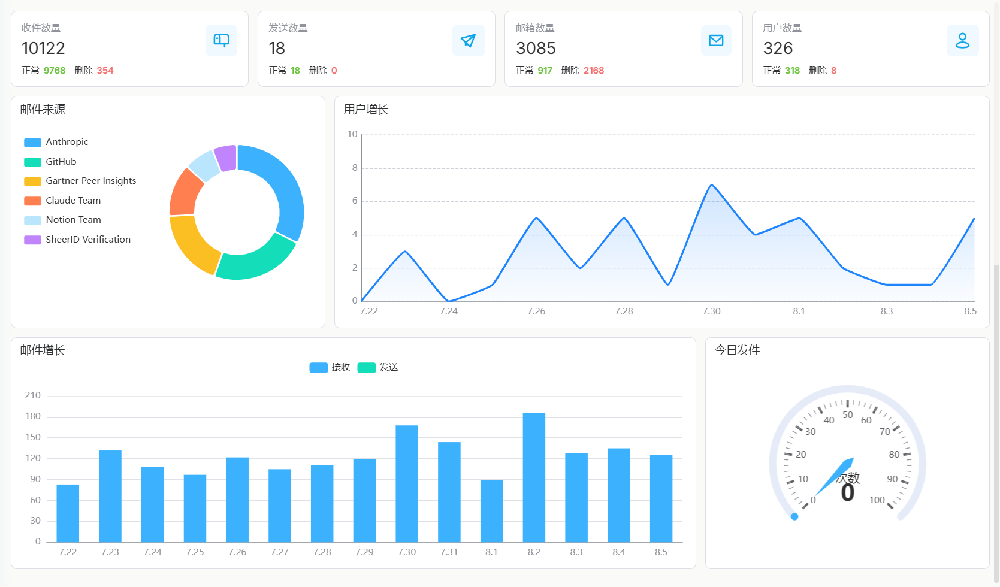 | 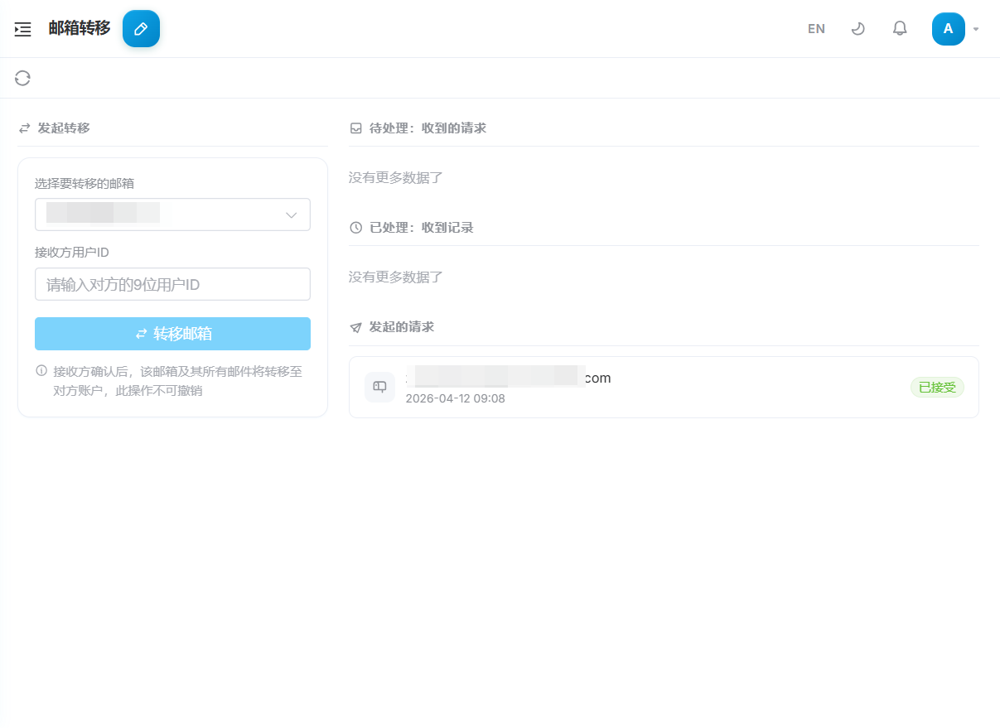 |
